# Simulador de Voo — Aterragem (Exercício 2)

Trabalho 2 de Computação Gráfica. O objetivo do exercício 2 é simular a aterragem de um avião numa pista. Escolhemos uma avioneta parecida com um Cessna 172, a aterrar na pista 27. Está tudo feito em C++ com OpenGL 3.3 (perfil *core*), GLFW, GLEW e GLM.

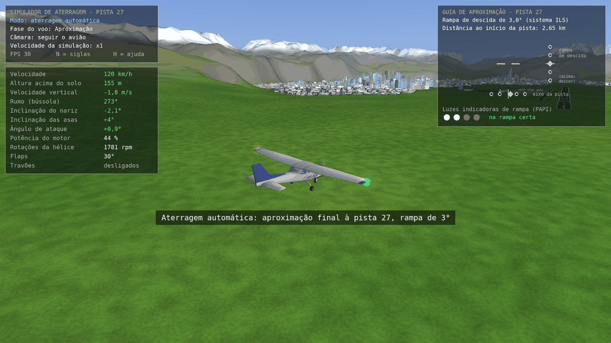

As imagens estão todas na pasta `docs/` e foram tiradas com a tecla `F12` do próprio programa.

## Compilar e correr

No Fedora basta instalar as bibliotecas e usar o `make`:

```bash
sudo dnf install gcc-c++ make glfw-devel glew-devel glm-devel mesa-libGL-devel
make          # compila e gera ./flightsim
./flightsim   # ou make run
make clean    # apaga o que foi compilado
```

Os `.o` ficam na pasta `obj/` e o `make` só recompila os ficheiros que mudaram. No VS Code, `Ctrl+Shift+B` corre o `make`.

Não é preciso correr o programa a partir de uma pasta específica. O caminho do projeto fica gravado no executável quando se compila, e é assim que ele encontra as pastas `assets/` e `shaders/`.

## O que o enunciado pedia e onde está

| Requisito | Onde está |
|---|---|
| Carregar os `.obj` da pista e do avião | `src/engine/mesh.cpp`, função `loadOBJ()`. Escrevemos o nosso próprio leitor, que aceita `v/vt/vn/f`, polígonos com mais de 3 lados e materiais `.mtl` |
| Rodar e transladar com rato e teclado (GLFW) | O rato roda as câmaras (`src/sim/camera.cpp`) e o teclado pilota o avião, que se move pela cena (*callbacks* em `src/main.cpp`) |
| Luz pontual | `src/sim/environment.h`. É o "sol", e as teclas I e K fazem-no rodar à volta da cena |
| Phong *shading* | `shaders/phong.vert` e `shaders/phong.frag`, com a iluminação calculada por fragmento |
| A aterragem em si | `src/sim/aircraft.cpp`, com um modo automático e outro manual |

## Controlos

| Tecla | O que faz |
|---|---|
| `1` `2` `3` `4` (ou `C`) | câmara atrás do avião / cockpit / livre / torre de controlo |
| arrastar o rato | rodar a câmara |
| roda do rato | zoom |
| `Espaço` | no cockpit, voltar a olhar em frente |
| `M` | trocar entre aterragem automática e manual |
| `↑` `↓` | baixar / subir o nariz |
| `←` `→` | inclinar o avião para os lados (dá a volta completa) |
| `Z` `X` | leme |
| `T` `G` | mais / menos motor |
| `F` `V` | *flaps* |
| `B` | travões (manter carregado) |
| `I` `K` | rodar o sol para um lado ou para o outro (dia, pôr do sol, noite) |
| `+` `-` | acelerar / abrandar a simulação |
| `P` / `R` | pausa / recomeçar |
| `H` | ajuda no ecrã |
| `Tab` | esconder todos os painéis |
| `O` | esconder só o painel da direita |
| `N` | mostrar siglas (IAS, ALT...) em vez dos nomes por extenso |
| `F12` | captura de ecrã |
| `Esc` | sair |

## Extras implementados

- **Aterragem automática**: o avião segue a rampa de 3° do ILS, corrige o desvio lateral, faz o *flare* a 6 m, toca, trava e para sozinho.
- **Pilotagem manual com física**: sustentação, resistência do ar, motor, peso e perda de sustentação (*stall*) a partir dos 15° de ângulo de ataque.
- **Rotação sem limites**: a orientação do avião é uma matriz de rotação, por isso dá para rodar 360°, voar de cabeça para baixo e fazer loopings.
- **Explosão**: uma aterragem brusca ou um choque contra um prédio fazem o avião explodir, com fogo, faíscas e fumo feitos com partículas.
- **Hélice animada**: roda à velocidade do motor, fica desfocada quando acelera (como numa filmagem) e para quando o motor se desliga.
- **Quatro câmaras**: atrás do avião, cockpit, câmara livre e torre de controlo, que segue o avião e ajusta o zoom à distância.
- **Cockpit com instrumentos**: velocidade, horizonte artificial, altímetro, velocidade vertical e bússola, mais um HUD verde no para-brisas.
- **Painéis em português**: dados de voo em unidades métricas e guia de aproximação (ILS e PAPI); a tecla `N` troca para as siglas de aviação.
- **Ciclo dia/noite**: as teclas `I` e `K` rodam o sol à volta da cena, e a cor da luz, o céu e o nevoeiro mudam com a altura do sol.
- **Céu procedural (em vez de *skybox*)**: o céu é calculado no shader (`sky.frag`), com gradiente, sol, brilho à volta do sol e estrelas à noite, e muda com a hora do dia.
- **Texturas**: o avião usa a textura `diffuse.ppm` do `.mtl` (com *mipmaps*) e o texto dos painéis vem de uma textura com as letras (`font.pgm`).
- **Luzes da pista**: luzes de borda, de entrada e de fim, barras de aproximação com *flashes* sequenciais, caminhos de circulação a azul e PAPI funcional.
- **Cidade gerada por código**: 12 bairros com ruas em ângulos diferentes, arranha-céus, autoestradas curvas ligadas ao aeroporto e janelas acesas à noite.
- **Aeroporto**: terminal, torre de controlo, hangares, aviões estacionados, parque de estacionamento e hotel.
- **Terreno**: colinas e montanhas com neve geradas com ruído, planas debaixo da cidade e do aeroporto.
- **Desempenho**: vértices repetidos fundidos, *frustum culling* por blocos e todos os edifícios numa só malha, para correr bem com a cidade inteira.

## Imagens

| Voo invertido em modo manual | O mesmo, visto do cockpit |
|---|---|
| 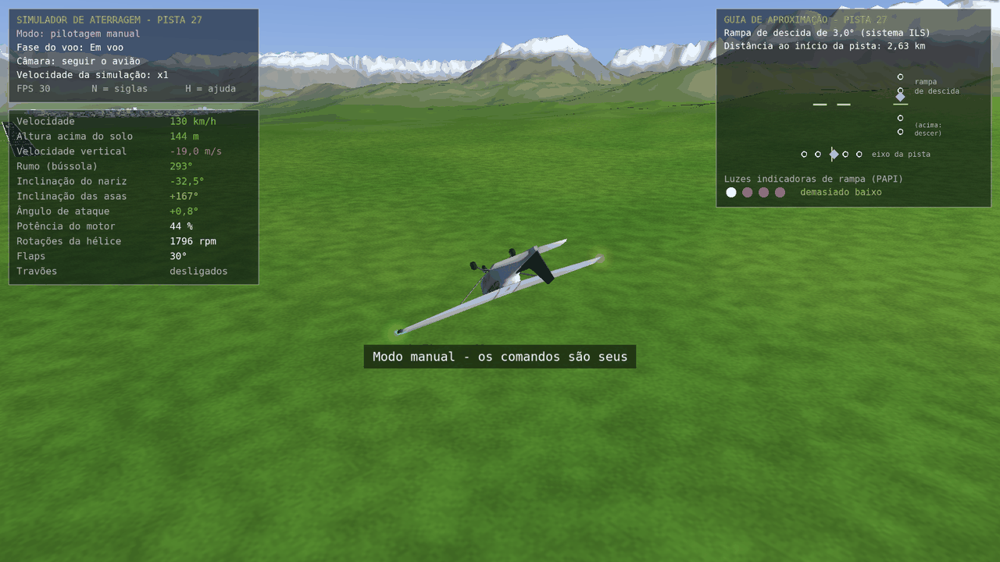 | 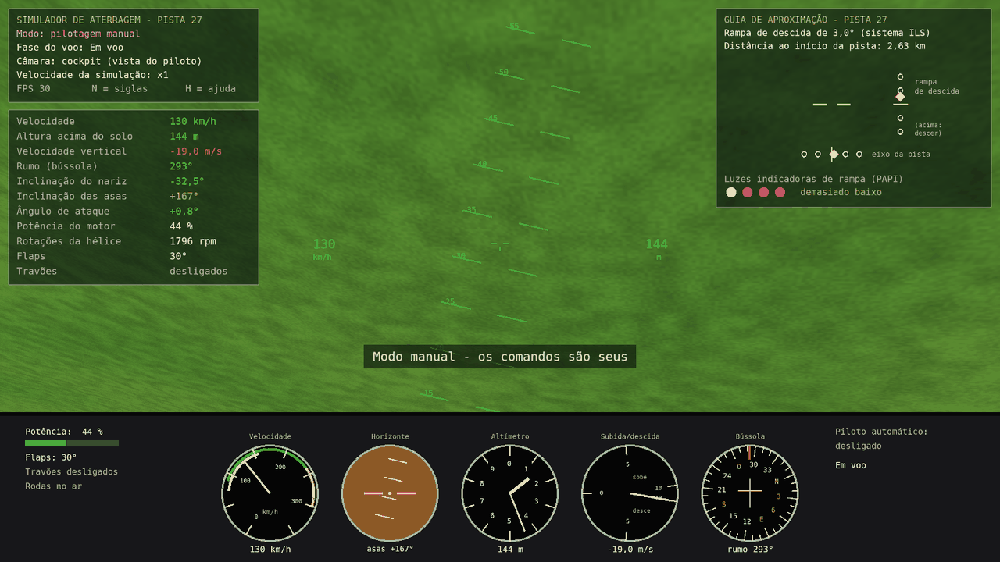 |

| Aterragem demasiado brusca | Câmara da torre de controlo |
|---|---|
| 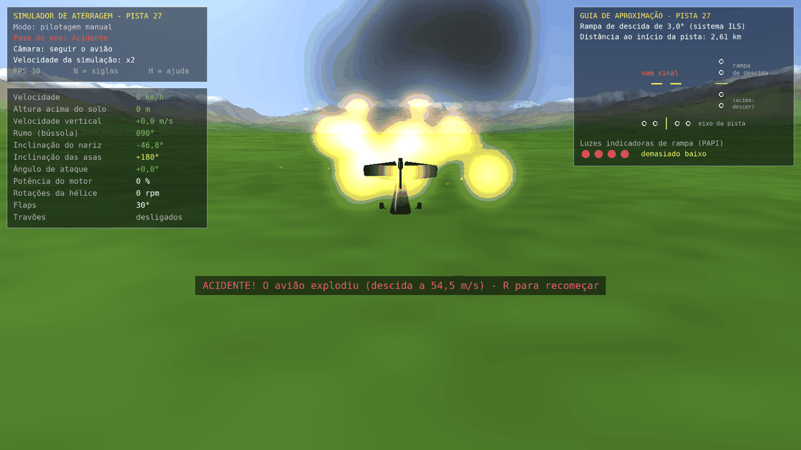 | 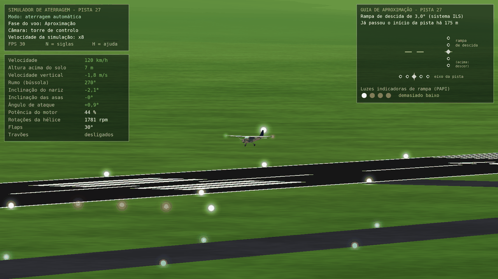 |

| Cockpit | Cockpit com siglas (`N`) |
|---|---|
| 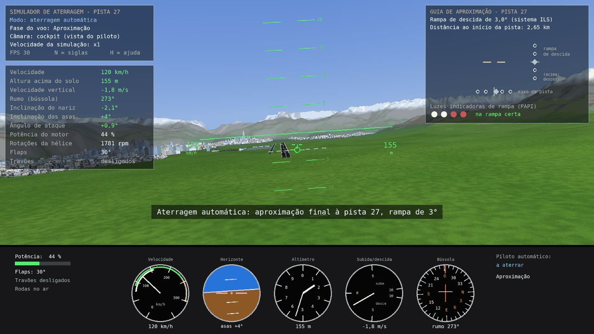 |  |

| O aeroporto e a cidade vistos do ar | A cidade à frente da pista |
|---|---|
| 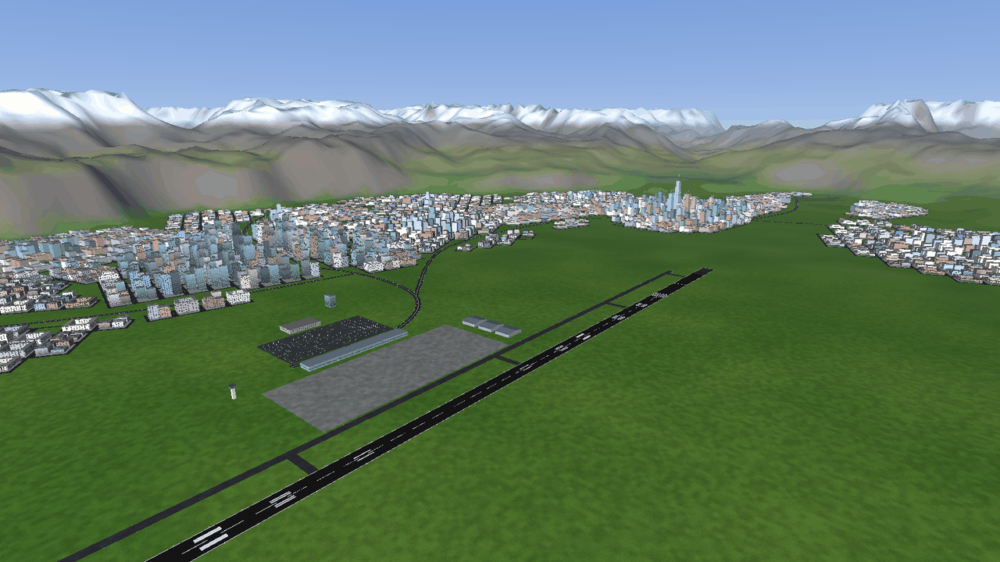 | 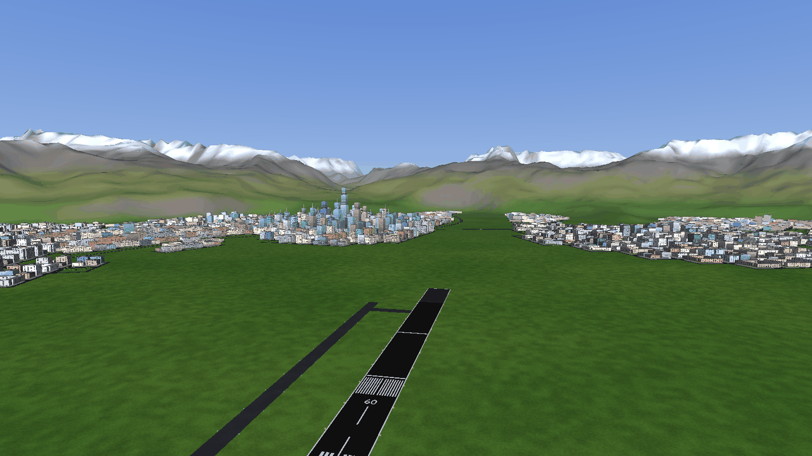 |

| O centro de dia | O centro à noite |
|---|---|
| 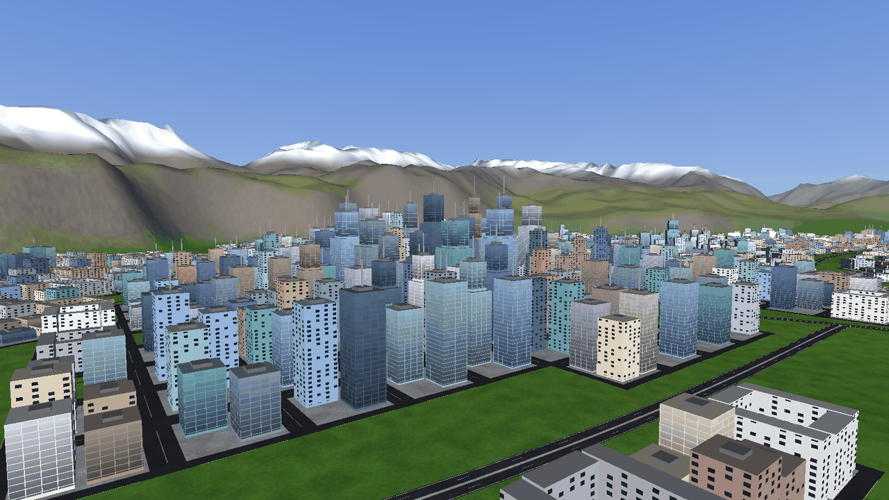 | 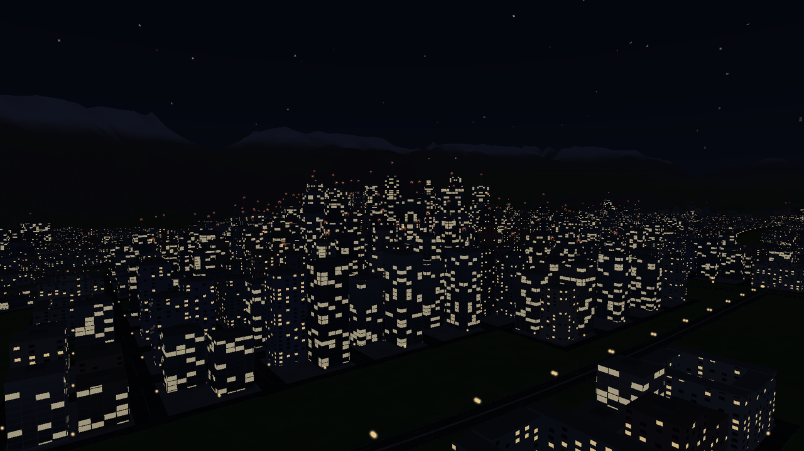 |

| Luzes da pista à noite | Ajuda no ecrã (`H`) |
|---|---|
| 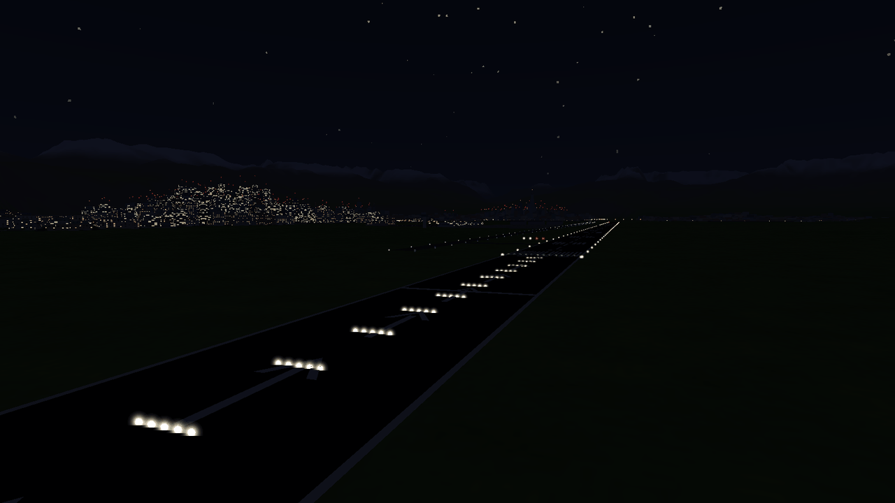 | 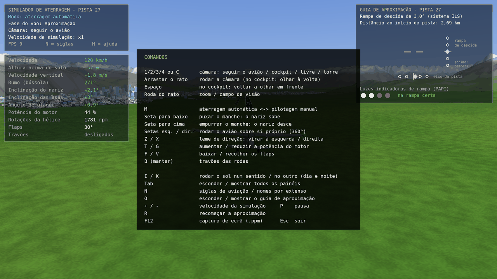 |

## Organização do código

```
src/
  main.cpp         janela, teclado/rato e o ciclo principal
  engine/          a "base" de OpenGL
    gl_utils       compilar shaders, ler texturas, capturas de ecrã
    mesh           malhas (VAO/VBO) e o leitor de .obj
    vertex.h       formato dos vértices
    frustum.h      teste de visibilidade (frustum culling)
  sim/             a simulação (não desenha nada)
    aircraft       física do avião e piloto automático
    camera         as quatro câmaras
    environment    sol, céu, dia e noite
    explosion      partículas da explosão
  world/           o cenário
    airport        pista, luzes, PAPI, aeroporto e cidade
    terrain        terreno com colinas e montanhas
    world_mesh     transforma os edifícios em triângulos
  render/          o que aparece no ecrã
    renderer       desenho da cena 3D
    hud            painéis, instrumentos do cockpit e ajuda
shaders/           phong, céu, luzes/partículas e HUD
assets/            pista, avião, textura e fonte
```

Cada parte tem um `.h` com as declarações e um `.cpp` com a implementação (o `vertex.h` e o `frustum.h` são tão pequenos que só têm o `.h`).

## Opções na linha de comandos

- `--size 1280x720` abre uma janela mais pequena, o que ajuda se o computador for lento.
- `--no-msaa` desliga o antialiasing.
- `--cam x,y,z,yaw,pitch` arranca com a câmara livre num sítio à escolha. Por exemplo, `./flightsim --cam -900,700,-900,40,-16` mostra o aeroporto e a cidade vistos do ar.

## Se algo correr mal

- **Está muito lento.** Ao arrancar, o programa escreve qual é a placa gráfica. Se aparecer `llvmpipe` ou `software`, não está a usar a GPU.
- **O `glewInit` falha (Wayland).** Experimenta `XDG_SESSION_TYPE=x11 ./flightsim`.
- **Aparece "Initialisation failed".** As pastas `assets/` e `shaders/` têm de estar junto ao projeto. Também se pode passar o caminho como argumento: `./flightsim /caminho/do/projeto`.
- **Queres outra textura.** O programa lê `.ppm`, por isso converte-a primeiro com `convert imagem.png imagem.ppm`.

## Créditos

- Pista: "RUNWAY" de pranav27 no Sketchfab (CC-BY-4.0). Convertemo-la para OBJ e ajustámos as cores.
- Avião: o `airplane.obj` gratuito indicado no enunciado (CGTrader).
- Fonte do HUD: DejaVu Sans Mono, convertida para uma imagem `font.pgm`.
